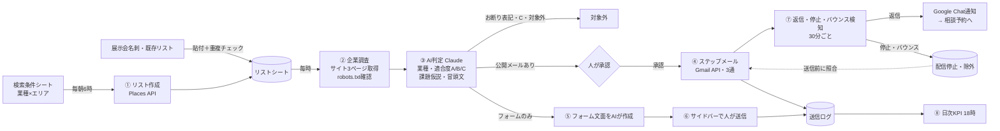

# AI×GAS 営業リード獲得の自動化・仕組み化 設計書

**対象**：グロウクロス（自社の新規開拓）。同じ仕組みを、顧客企業向けの「営業DX・AI活用支援」の提供メニューとしても使えます。
**作成日**：2026-11-24　**版**：v1.0（初版）
**成果物**：本設計書／導入手順書 [`SETUP.md`](SETUP.md)／Google Apps Script 一式 [`gas/`](gas/)

> 表記ルール：**【事実】**＝ご提供情報・プロファイルで確認済み、**【仮説】**＝検証前の想定、**【目安】**＝試算値です。根拠のない実績・数値は記載していません。

---

## P1. 資料タイトル

**「リスト作成から初回接触までを1つのスプレッドシートで回す」AI×GAS 営業リード獲得の仕組み**
— 営業リスト作成・企業調査・メール営業・フォーム営業・返信管理を、Google Workspace の中で自動化する —

- 図表案：表紙。中央に「リスト作成 → 調査 → 接触 → 返信 → 商談」の5段の矢印、右下にGoogleスプレッドシートとGmailのアイコン。

---

## P2. 提案背景

**要点**：中小企業向けの営業支援は「信頼される1対1の接点」が必要な一方、1人で新規開拓を回すと、リスト作成と調査に時間が取られ、接触数が不足します。

**詳細**
- 【事実】自然検索からの流入は、Google 100位以内のランクインキーワードが0件（2026-11-17時点）で、問い合わせを待つ集客は立ち上げ途中です。広告は未出稿です。
- 【事実】Google Workspace（Gmail・カレンダー・Meet）を利用しており、追加のSaaSを契約せずにGASで連携できる環境があります。
- 【仮説】SEO・SNSで「待つ集客」を育てる間、成果が出るまでの数か月を「取りにいく集客」（アウトバウンド）で補う必要があります。

- 図表案：横軸＝月、縦軸＝相談件数。「SEO・SNS（立ち上がりに時間）」の曲線と「アウトバウンド（早期に件数を作る）」の棒を重ねたイメージ図（数値は入れない）。

---

## P3. 顧客（自社）の現状

**要点**：営業リストの作成から送信・記録まで、手作業が前提になっています。

| 業務 | 現状【仮説】 | 1社あたりの手間【目安】 |
|---|---|---|
| リスト作成 | 地図検索・ポータルで企業を探し、表に転記 | 3〜5分 |
| 企業調査 | サイトを開いて事業内容・問い合わせ先・お断り表記を確認 | 5〜10分 |
| 文面作成 | テンプレートを企業ごとに書き換え | 5分 |
| 送信・記録 | Gmail・フォームから送信し、表に記録 | 3〜5分 |
| 追客 | 何日後に再送するかを手で管理 | 漏れやすい |

- 図表案：上表をそのままスライドの表に。合計の手間（1社あたり約15〜25分【目安】）を右端に強調表示。

---

## P4. 解決すべき課題

**要点**：課題は「件数」「質」「継続」「安全性」の4つです。

| 区分 | 課題 |
|---|---|
| 経営課題 | 相談予約（最優先CV）の件数が安定せず、売上の見通しが立てにくい |
| 営業課題 | 新規接触数が少ない。追客（2通目・3通目）が漏れる。返信への初動が遅れる |
| マーケティング課題 | 業種（製造業・サービス業・不動産・介護）ごとに訴求を変えられていない |
| 業務課題 | リスト作成・調査・記録に時間を取られ、商談準備の時間が足りない |
| 法務・信用の課題 | 配信停止・お断り表記への対応を人の注意力に頼っており、送ってはいけない相手に送るリスクがある |

- 図表案：4象限（件数／質／継続／安全性）に課題を配置。

---

## P5. 課題の原因

**要点**：原因は「データが散らばっている」「判断がその場任せ」「ルールが仕組みになっていない」の3点です。

1. **データの分散**：リスト・送信履歴・返信・停止依頼が別々の場所にあり、重複送信や停止漏れが起きやすい。
2. **調査と判断の属人化**：どの企業に、どの切り口で連絡するかを毎回考えている。
3. **ルールの未実装**：送信上限・営業時間・お断り表記の確認・停止対応が「気をつける」運用になっている。

- 図表案：原因→課題の対応を矢印でつないだロジックツリー。

---

## P6. 提案コンセプト

**要点**：**「AIが調べて書き、GASが守って送り、人は判断と商談に集中する」**

- **1つのスプレッドシートに集約**：リスト・調査結果・送信履歴・停止リスト・KPIを1か所で管理します。
- **AIは“下書き係”**：Claude（AI）が企業サイトを読み、業種・適合度・課題仮説・冒頭の一文を作成します。最終判断（承認）は人が行います。
- **ルールはコードに入れる**：送信上限・営業時間・祝日・お断り表記・配信停止・バウンスを、送信直前に必ずプログラムで確認します。
- **フォーム営業は半自動**：文面はAIが作り、送信は人が行います（自動投稿ボットは使いません）。

- 図表案：人／AI／GASの役割分担を3列で示す図。

---

## P7. 具体的な施策（システム設計）

### 7-1. 全体構成

### 7-2. 機能一覧

| No | 機能 | 処理内容 | 実行 | ファイル |
|---|---|---|---|---|
| ① | リスト作成 | 業種キーワード×エリアで Google Places API（Text Search）を検索。営業中の企業のみ、place_id・ドメインで重複除外。ポータル・SNSドメインは除外 | 毎日6時／手動 | `ListBuilder.gs` |
| ①' | 手動取込 | 名刺・既存顧客・購入リストを貼り付け → 重複・除外チェック | 手動 | `ListBuilder.gs` |
| ② | 企業調査 | robots.txt を確認し、トップ・問い合わせ・会社概要の最大3ページを取得。公開メール・フォーム有無・CAPTCHA・「営業お断り」「広告メールお断り」表記を判定 | 毎時10社 | `Enrich.gs` |
| ③ | AI判定 | Claude が業種・事業概要・適合度（A/B/C/対象外）・判定理由・課題仮説・冒頭の一文をJSONで返す | ②と同時 | `Ai.gs` |
| ④ | ステップメール | 承認済みのA/B企業に3通（初回 → 4日後 → 7日後）。2通目以降は同じスレッドへの返信として送信。差し込み＋法定表示＋配信停止リンクを自動付与 | 平日9〜18時、30分ごと | `Mailer.gs` |
| ⑤ | フォーム文面作成 | メールがない企業向けに、500字以内の文面をAIが作成してキューへ | 毎日7時 | `FormSales.gs` |
| ⑥ | フォーム営業サイドバー | 問い合わせページのリンク、入力値・本文のコピー、結果（送信済／スキップ／お断り表記あり）の記録 | 人が操作 | `FormSidebar.html` |
| ⑦ | 返信・停止・バウンス検知 | スレッドに相手のメールが届いたら停止して通知。「配信停止」等の返信は自動で停止リストへ。mailer-daemon からのエラーはバウンスとして除外 | 30分ごと | `Mailer.gs` |
| ⑧ | 配信停止ページ | Webアプリで停止を受付（誤クリック対策の確認ボタン付き）。ワンクリック解除ヘッダーにも対応 | 常時 | `WebApp.gs` |
| ⑨ | 日次KPI | 送信・返信・停止・バウンス・累計返信率を記録し、Google Chatへ通知 | 毎日18時 | `Report.gs` |

### 7-3. シート設計

| シート | 主な列 | 役割 |
|---|---|---|
| 設定 | テストモード、送信前承認、1日の送信上限、送信時間帯、事業者名・住所、AIモデル、自社サービス概要、ターゲット条件 | 運用ルールを担当者が変更できる |
| 検索条件 | 実行、業種キーワード、エリア、最大件数、ステータス | リスト作成の指示 |
| リスト | ID、会社名、URL、公開メール、メール掲載URL、営業お断り、AI適合度、課題仮説、パーソナライズ文、アプローチ、承認、ステータス、ステップ、次回送信日、threadId | 1社1行。全工程の状態を管理 |
| メールテンプレート | ステップ、前回からの日数、件名、本文（`{{会社名}}` `{{パーソナライズ文}}` `{{課題仮説}}` `{{署名}}`） | 文面の管理 |
| フォーム営業キュー | 会社名、問い合わせURL、件名、本文、ステータス、対応者 | 半自動送信の作業台 |
| 送信ログ | 日時、種別、宛先、ステップ、結果、threadId | 監査証跡 |
| 配信停止・除外 | メール or ドメイン、理由 | 既存顧客・商談中・停止依頼・バウンスを登録。送信前に必ず照合 |
| KPI日次 | 送信、返信、商談化、停止、バウンス、累計返信率 | 効果測定 |

**ステータスの流れ**：新規 → （調査）→ 送信待ち／フォーム待ち／対象外／手動確認 → 送信中 → 返信あり → **商談化**（手動）／完了／配信停止／バウンス

### 7-4. 送信前チェック（ガードレール）

送信直前に次をすべて満たす場合だけ送ります（`checkSendable_` ほか）。

1. テストモードが OFF（ON の間はテスト送信先にだけ送り、ステータスは進めない）
2. 「承認」にチェックがある（送信前承認 ON の場合）
3. 平日・祝日以外・9〜18時
4. 当日の送信数が上限未満（初期値 30通/日、1回5通、1通ごとに20〜25秒の間隔）
5. 公開メールと、その**掲載元URL**が記録されている
6. 「営業お断り」「広告メールお断り」の表記がない
7. 配信停止・除外リスト（メール／ドメイン）に該当しない
8. AI適合度が A または B
9. 2通目以降は、送る直前にスレッドへの返信がないことを再確認

### 7-5. 優先順位（実装・運用の順番）

| 優先度 | 施策 | 理由 |
|---|---|---|
| 1 | 配信停止・除外リストに既存顧客・商談中の企業を登録 | 送ってはいけない相手への送信を最初に防ぐ |
| 2 | ①〜③ リスト作成・調査・AI判定 | 送信前でも「狙う企業の一覧」として価値がある |
| 3 | ④ メール（テストモード → 1日10通 → 30通） | 反応と停止率を見ながら段階的に増やす |
| 4 | ⑤⑥ フォーム営業 | メールがない企業への補完。人の作業時間を確保してから |
| 5 | ⑨ KPI・テンプレート改善 | 2週間分のデータがたまってから |

- 図表案：7-1の構成図を1枚、7-2の機能一覧を1枚、7-4のチェック項目を「信号」のアイコン付きで1枚。

---

## P8. 導入効果

**要点**：1社あたりの作業時間を減らし、その分を接触数と商談準備に回します。

| 項目 | 導入前【目安】 | 導入後【目安】 | 根拠 |
|---|---|---|---|
| 1社あたりの準備時間（リスト〜文面） | 約15〜25分 | 約1〜2分（承認・確認のみ） | 調査・文面作成をAIとGASが実施 |
| 1日の新規接触数（メール＋フォーム） | 数社【仮説】 | 30〜45社（メール30＋フォーム10〜15） | 設定上限の値 |
| 追客漏れ | 発生しやすい | 0（3通目まで自動） | ステップ管理を自動化 |
| 返信への初動 | 気づいた時 | 30分以内に通知 | 30分ごとの返信検知 |
| 停止・お断りへの対応 | 人の注意に依存 | 送信前に自動照合 | ガードレール |

**ランニングコスト【目安】**
- Claude API（Claude Opus 5.5、推論レベル low）：1社あたり入力約8,000トークン・出力約1,000トークンと仮定すると、約0.05ドル／社。月1,000社の調査で約50ドル。実際の使用量は Anthropic Console の利用状況で確認してください。
- Google Places API：検索回数に応じた従量課金。最新の料金・無料枠は Google Maps Platform の料金表で確認してください（本書では金額を記載していません）。
- GAS・Gmail・スプレッドシート：既存の Google Workspace の範囲内。

- 図表案：導入前後の比較表と、「浮いた時間 → 商談準備・提案書作成へ」の矢印図。

---

## P9. 実施体制

| 役割 | 担当 | 主な作業 | 時間【目安】 |
|---|---|---|---|
| 責任者・承認者 | 代表（中島） | 検索条件の決定、送信の承認、テンプレート確定、返信対応・商談 | 毎日15分＋返信対応 |
| 運用担当 | 代表または事務スタッフ（要確認） | フォーム営業サイドバーでの送信、手動確認リストの電話 | 1日30分 |
| 仕組みの保守 | 導入支援者（Claude Code での改修を含む） | トリガー・エラーの確認、テンプレート・判定基準の改善 | 月2時間 |
| 法務確認 | 顧問の専門家（要確認） | 特定電子メール法・個人情報保護法の確認、プライバシーポリシーの追記 | 導入時1回 |

---

## P10. スケジュール

| 週 | 作業 | 完了の基準 |
|---|---|---|
| 1週目 | スプレッドシート作成・コード反映・APIキー登録・SPF/DKIM/DMARCの確認、除外リスト登録、法務確認の依頼 | 「初期設定」が完了し、テストモードで自分宛てに3通届く |
| 2週目 | 業種×エリアを各業種2条件で実行（計8条件・約160社）。AI判定を目視で20社確認し、判定基準・テンプレートを調整 | 適合度の判定に違和感がないことを確認 |
| 3週目 | 本番開始：1日10通＋フォーム5件。返信・停止・バウンスの検知を確認 | 停止リンク・返信通知が正しく動く |
| 4週目 | 1日30通＋フォーム10件へ拡大。KPIを確認し、業種別に件名・冒頭文を見直す | 2週間分のKPIがそろう |
| 2か月目以降 | 業種別テンプレートのA/Bテスト、返信企業の相談予約（Jicoo）への誘導、CRM連携 | 月次で改善を1つ以上実施 |

- 図表案：4週間のガントチャート。

---

## P11. KPI

| 段階 | KPI | 目標【仮説・初期値】 | 判断の目安 |
|---|---|---|---|
| 量 | 調査完了数／週 | 150社 | 下回る場合は検索条件を追加 |
| 量 | 接触数（メール＋フォーム）／週 | 150〜200社 | 上限設定どおりか |
| 質 | 送信対象（A/B）比率 | 50%以上 | 下回る場合は検索キーワードを見直す |
| 反応 | 返信率（返信÷接触社数） | 1〜3% | 業種別に比較し、低い業種の文面を変更 |
| 成果 | 商談化数（相談予約）／月 | 3〜6件 | 返信から相談予約への誘導を改善 |
| 安全 | 配信停止率（1通あたり） | 1%未満 | 超えたら送信数を減らし、文面・対象を見直す |
| 安全 | バウンス率 | 2%未満 | 超えたらアドレスの取得ルールを見直す |

> 目標値は一般的な水準を参考にした仮説です。2週間の実績で再設定してください。

---

## P12. リスクと対策

| リスク | 対策（本設計での実装） | 確認先 |
|---|---|---|
| **特定電子メール法**：広告宣伝メールは原則として事前同意が必要。ただし、営業を営む者がWebサイトで公表しているアドレスへの送信は例外とされる（「広告メールお断り」等の表示がある場合を除く） | ①掲載元URLを記録したアドレスにのみ送信 ②お断り表記のある企業は除外 ③送信者名・住所・問い合わせ先・配信停止方法を全メールに自動付与 ④停止依頼は即時に停止リストへ | **運用前に法務確認**（総務省・消費者庁のガイドライン） |
| フォーム営業：特定電子メール法の対象外とする解釈が一般的だが、相手の業務負担・サイト規約の問題がある | 自動投稿をしない（人が送信）。お断り表記・CAPTCHAを表示し、人が最終確認 | 法務確認 |
| 個人情報保護法：個人名入りのアドレスは個人情報に当たる場合がある | 代表・問い合わせ用アドレスを優先。プライバシーポリシーに「営業活動への利用」を明記 | 法務確認 |
| Webサイトの取得（クローリング） | robots.txt の全面禁止を尊重。1社最大3ページ・1秒間隔・UA明示 | — |
| Google Maps Platform の規約（取得データの保存制限） | 規約を確認し、必要に応じて place_id 以外の保存期間を見直す | **導入前に規約確認** |
| 送信ドメインの評価低下（迷惑メール判定） | SPF・DKIM・DMARCを設定。30通/日から段階的に増やす。停止率・バウンス率を日次監視 | Google Workspace 管理コンソール |
| AIの誤判定・不自然な文面 | 構造化出力（JSON）で形式を固定。事実の創作を禁止するプロンプト。送信前承認 | 運用者 |
| ワンクリック解除が受信環境で動かない | GASのWebアプリはリダイレクトを伴うため。mailto と返信での停止を併記 | — |

---

## P13. 今後の展開

1. **相談予約への直結**：返信企業に Jicoo の予約URLを自動で返す下書きを作成（`/consultation/`、`consultation_booked` 計測と連携）。
2. **CRM・MA連携**：返信・商談化したリードを本リポジトリの自社MA（`sync_lead_activity` → `score_and_qualify_leads`）に取り込み、育成メールへ。
3. **業種別の最適化**：業種ごとにテンプレートを分け、返信率でA/Bテスト。
4. **公的データでの補強**：国税庁 法人番号Web-API・gBizINFO で正式名称・所在地を照合（アプリケーションIDの申請が必要）。
5. **顧客向けメニュー化**：「AI×GAS 営業リスト自動化 導入支援」として、製造業・不動産・介護事業者へ提供。

---

## P14. まとめ・次のアクション

**まとめ**：リスト作成・調査・文面作成・追客・停止対応を1つのスプレッドシートとGASに集約し、AIは下書き、人は承認と商談に集中する仕組みです。法令・信用に関わるルールは送信直前にプログラムで確認します。

| No | 次のアクション | 担当 | 期限【目安】 |
|---|---|---|---|
| 1 | 下記「確認したい事項」へのご回答 | 中島様 | 3営業日 |
| 2 | スプレッドシート作成とコード反映（`SETUP.md` の手順1〜5） | 導入担当 | 1週目 |
| 3 | 既存顧客・商談中企業を「配信停止・除外」に登録 | 中島様 | 1週目 |
| 4 | 法務確認（特定電子メール法の表示事項・プライバシーポリシー） | 中島様・専門家 | 2週目まで |
| 5 | テストモードでの動作確認 → 本番開始 | 導入担当・中島様 | 3週目 |

### 確認したい事項（重要なものだけ）

1. **送信元アドレス**：本人のアドレス（例：代表者のアドレス）か、営業専用のエイリアスか。SPF・DKIM・DMARCの設定状況。
2. **表示事項**：特定電子メール法の表示に使う正式な事業者名と住所。
3. **最初に狙う業種×エリア**：重点4業種のうち、どこから始めるか（全国対応のため、実績を作りやすい地域があれば優先）。
4. **除外先**：既存顧客・商談中・取引先のドメイン一覧。
5. **フォーム営業の担当者**：代表ご自身か、事務スタッフか（1日30分程度の作業）。
